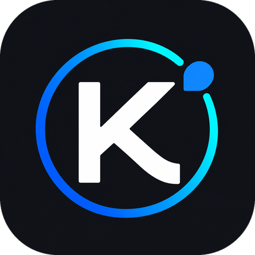

<div align="center">
  
  <h1>Kimi Code for HarmonyOS PC</h1>
  <p>Use Kimi Code on your HarmonyOS computer.</p>
  <p>
    <a href="https://github.com/TranswarpDrive/kimi-code-hmos/releases/tag/v0.2.0">Download v0.2.0</a> ·
    <a href="docs/INSTALL.md">Installation guide</a> ·
    <a href="README.md">中文</a>
  </p>
  <p>Public preview · HarmonyOS PC / API 26 · MIT</p>
</div>

An unofficial HarmonyOS PC port of [Kimi Code](https://www.kimi.com/code). It bundles the Kimi Code Web UI and its runtime in a standalone app, so you can work with your local projects without installing Node, Python or Git separately.

## Download and install

1. **[Download the HAP](https://github.com/TranswarpDrive/kimi-code-hmos/releases/download/v0.2.0/KimiCode-hmos-0.2.0-kimi2.2.0-release-unsigned.hap)**. This is the only file you need to download.
2. Sign it for your own device with a tool that supports HarmonyOS PC apps, then install it. Follow the [installation guide](docs/INSTALL.md) for the required signing settings.
3. Open the app, sign in to Kimi and select your project folder.

> The HAP needs your own signature before installation. It supports **HarmonyOS PC / 2in1, API 26** only; phones and tablets are not supported. Model access requires your own Kimi account and an available service plan.

`SHA256SUMS` is an **optional checksum list**, not an installation dependency. If you want to check that your download is intact, see the [verification instructions](docs/INSTALL.md).

## What you can do

- Chat with Kimi Code and work on code and project files in a dedicated window.
- Choose a local project folder, upload files, search sessions and export conversations.
- Use the bundled Python, Git and ripgrep through Kimi's Shell tool.
- Switch folders, restart the service or view logs from the toolbar.

## Before you start

| Item | Current status |
| --- | --- |
| Web terminal | Unavailable; use Kimi's Shell tool to run commands |
| File exports | Session ZIPs and browser-generated files are limited to 32 MiB per download |
| Upgrades | Keep the same signing certificate and install in place; uninstalling removes the app's login state and sessions |

This is a public preview tested on a MOR-M1 running API 26. Other devices, fresh installations and extended use still need further testing. See the [validation record](docs/RELEASE-VALIDATION.md) for the exact coverage.

Found a problem? [Open an issue](https://github.com/TranswarpDrive/kimi-code-hmos/issues/new?template=bug_report.yml) with your system version, signing tool and steps to reproduce it. Remove credentials and private conversations from logs before attaching them.

## Build from source

Full builds have been validated on macOS Apple Silicon with DevEco Command Line Tools 26. After setting up the prerequisites, run this from the project directory:

```bash
KIMI_UNSIGNED_ONLY=1 scripts/build.sh release
```

The [build guide](docs/RELEASING.md) covers prerequisites, signing and tests. For implementation details, see the [project guide](CLAUDE.md) and [HarmonyOS porting notes](docs/HARMONYOS-NOTES.md).

## Contributors and AI assistance

Maintained by [@TranswarpDrive](https://github.com/TranswarpDrive), with development assistance from:

- **Claude (Anthropic)**: the initial port and project setup.
- **kimi-k3**: subsequent feature improvements.
- **[Codex (OpenAI)](https://github.com/codex)**: stability fixes, tests and release improvements for 0.2.0.

## License

The project code uses the [MIT license](LICENSE). Bundled components keep their own [licenses](THIRD-PARTY-NOTICES.md). This is a community port, not an official Moonshot AI or Huawei project.
